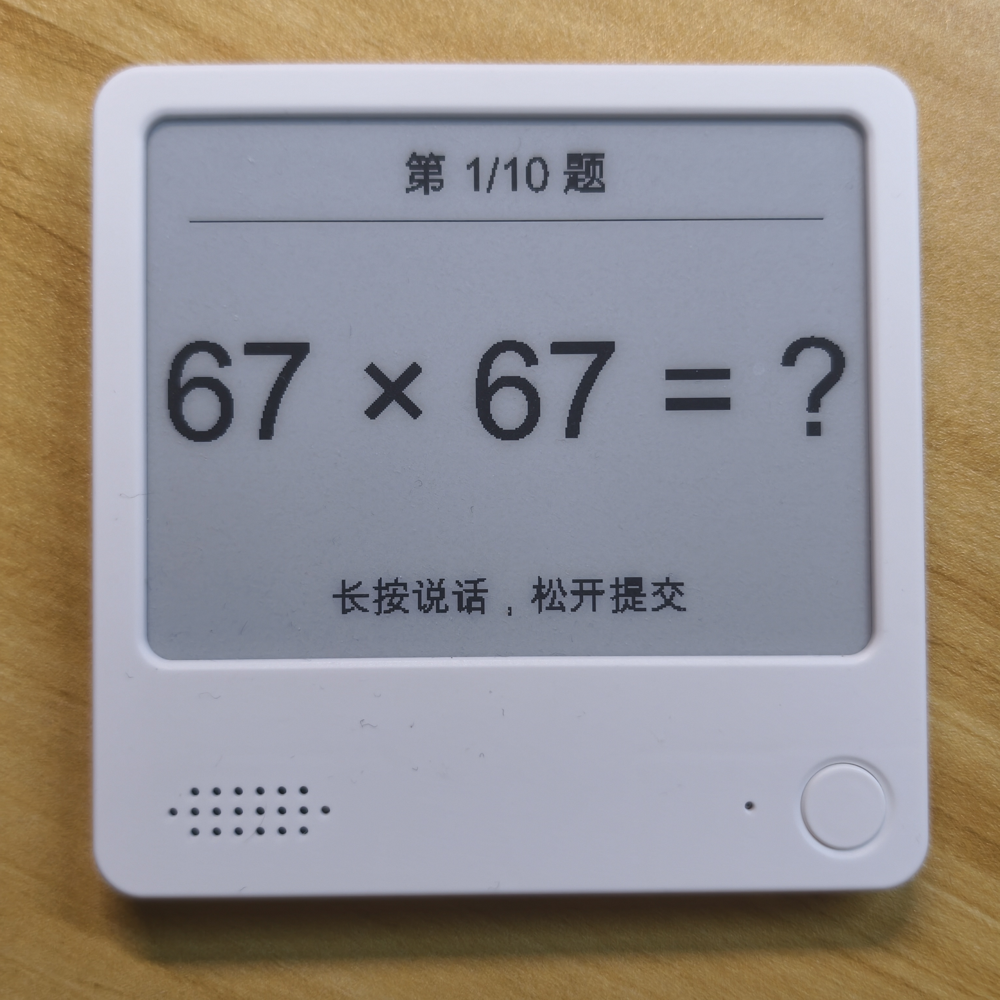
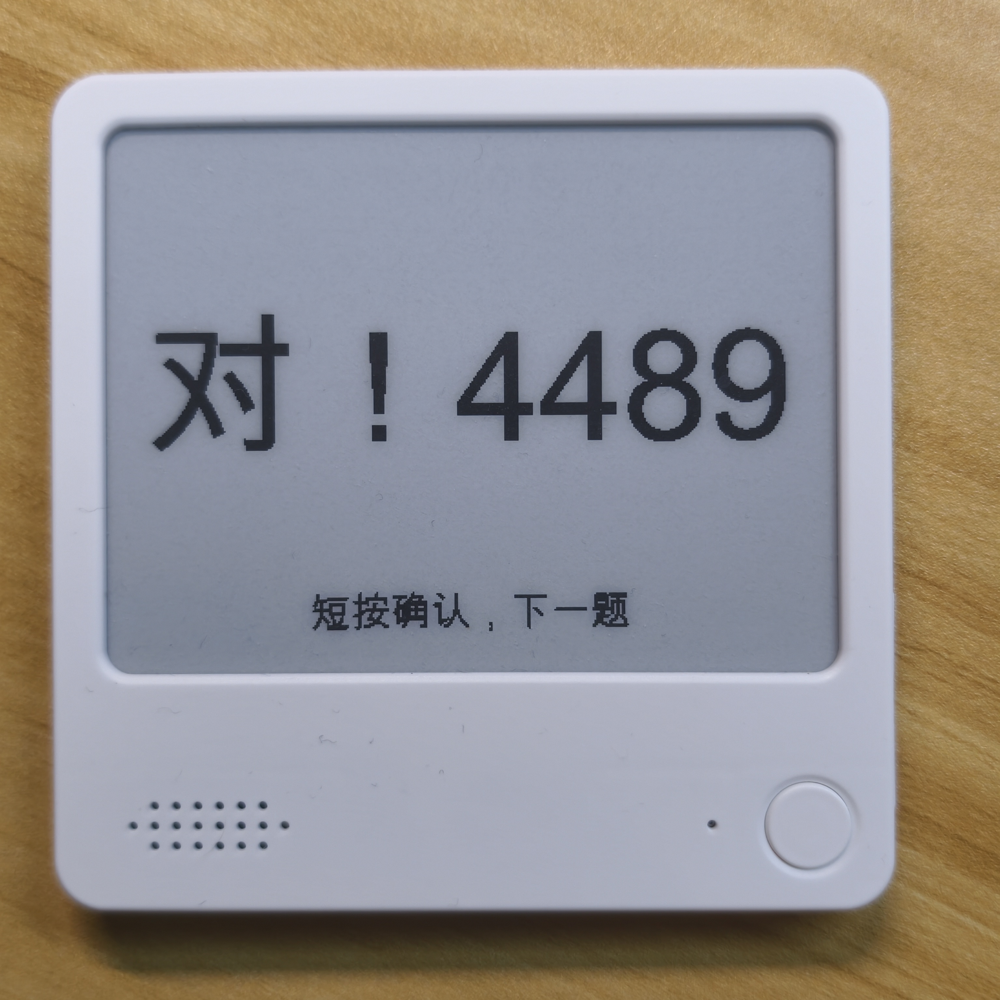

# zectrix-math-drill Mental Math Drill

**English** | [简体中文](README.md)

A mental-math drill app for the ZECTRIX Note 4 e-ink display: the screen shows a question,
the child **presses and holds a button and speaks the answer**, a fully local speech model
transcribes it to an integer, the app grades it and shows the result on the e-ink screen,
with a session summary at the end. All speech processing stays on your machine.





## Features

- Question modes: entry (10–30) / basic (10–99) / advanced (25–99) / **squares** (n², n∈10–99)
- No duplicates within a session (optional swap dedup: 23×14 equals 14×23); reproducible seeds
- Chinese number parsing: place-value readings, digit-by-digit readings, colloquial
  omissions, 两/幺 normalization, Arabic digits; ambiguous or self-corrected speech is
  **always re-asked, never silently guessed**
- Grading & stats: first-answer accuracy, corrections, unparseable attempts; every attempt
  is recorded in SQLite
- Resumable sessions: `--resume` after a restart or disconnect
- Service mode: auto-reconnect when the device sleeps or the network hiccups; the screen
  restores automatically

## Hardware & system requirements

| Item | Requirement |
| --- | --- |
| Device | **ZECTRIX Note 4 (zectrix-s3-epaper-4.2), firmware 3.7.5 (zh-CN)**. Note 4C is not supported; firmware must not be cross-flashed |
| Host | macOS on Apple Silicon (local ASR uses MLX/Metal); porting notes in [THIRD_PARTY_NOTICES](THIRD_PARTY_NOTICES.md) |
| Font | A TTF font with CJK glyphs (macOS ships Arial Unicode; set `ZECTRIX_FONT` elsewhere) |
| Network | Host and device on the same LAN; connect by device IP (reserve it via DHCP) |
| ASR model | Qwen3-ASR-1.7B-8bit downloads on first run (~2GB, HuggingFace cache; falls back to hf-mirror when huggingface.co is unreachable) |

> Device tips: while parked on "Settings → Network sync", remote screens are not rendered;
> with media volume at 0, playback "succeeds" silently. On first use, verify the question
> is visible on the home screen and play a test tone (see the `tone` tool).

## Usage

```sh
# 1. Core drills (no device needed): type ASR text in the terminal
cargo run -- -n 10 -d square          # squares; empty input = silence; q = abort

# 2. Voice answering on the e-ink device (clone the SDK alongside, enable `device`)
git clone https://github.com/itopinion/zectrix-local-push-sdk ../repos/zectrix-local-push-sdk
cargo build --features device
./target/debug/drill_device 192.168.31.77 --count 10 --difficulty square
./target/debug/drill_device 192.168.31.77 --resume <session-id>   # resume

# 3. Utilities
./target/debug/asr_probe 'recording.wav=322'  # offline: WAV → ASR → parse → grade
./target/debug/tone 192.168.31.77 100         # device tone test (catches muted volume)
```

Device keys: **hold CONFIRM** to speak, release to submit; short-press CONFIRM for the
next question; UP short re-shows the question; DOWN short aborts (progress is kept).

The ASR worker needs a Python environment:
`python3 -m venv asr-env && asr-env/bin/pip install mlx-audio`. The host looks for
`../asr-env/bin/python` and `workers/asr_worker.py` (override with `--python/--script`).

## Architecture

```
src/
  question.rs  question engine (difficulty / dedup / reproducible seeds)
  parser.rs    Chinese number parsing (total function: never panics, never guesses)
  session.rs   session & grading (stale rejection, idempotent retries, first-answer stats)
  store.rs     SQLite (sessions / questions / attempts)
  app.rs       orchestration (write-through persistence, resume)
  render.rs    400×300 card rendering (baseline-aligned, bilevel output: zero dithering noise)
  asr.rs       ASR worker client (JSON-lines subprocess, lockstep + timeouts)
  display.rs   display-intent layer (text; the device implementation is render.rs)
  main.rs      CLI (simulates ASR text input)
  bin/drill_device.rs  device main loop (feature `device`)
workers/asr_worker.py  local ASR (Qwen3-ASR-1.7B-8bit / mlx-audio)
```

Design decisions are collected in [docs/DESIGN.md](docs/DESIGN.md).

## Tests

```sh
cargo test                 # 39+ cases: adversarial parser fuzzing, grading invariants, stats, persistence
cargo test --features device
cargo clippy --all-targets
```

## Data & privacy

- Recordings are used for recognition only and **deleted immediately afterwards** by default
  (`--keep-audio` keeps them for debugging); both audio and inference stay on this machine
- Practice records (questions, answers, scores) live in a local SQLite file (`data/`);
  nothing is uploaded anywhere
- The repository contains no personal data: `data/`, recordings and model caches are
  gitignored
- For children, follow minimal collection; if you keep samples for recognition-quality
  review, do so deliberately and store them safely

## Known limitations

- Interactive practice requires the host program to keep running; no third-party code runs
  on the device (that is the official SDK model)
- Screen refresh takes ~1–3s (gray16 fast refresh) — the flow is one-question-one-answer,
  not animation-friendly
- Reconnection is a 10s polling loop; recognition failures prompt a retry without grading;
  wrong-question drills and adaptive difficulty are on the roadmap

## License

Code under MIT, see [LICENSE](LICENSE); third-party components in
[THIRD_PARTY_NOTICES.md](THIRD_PARTY_NOTICES.md).
