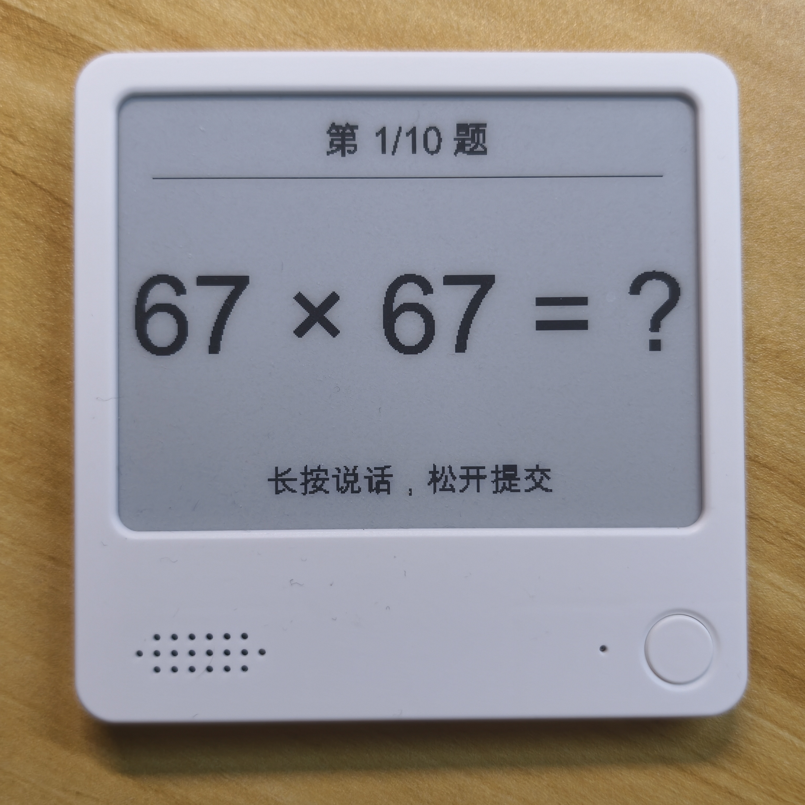
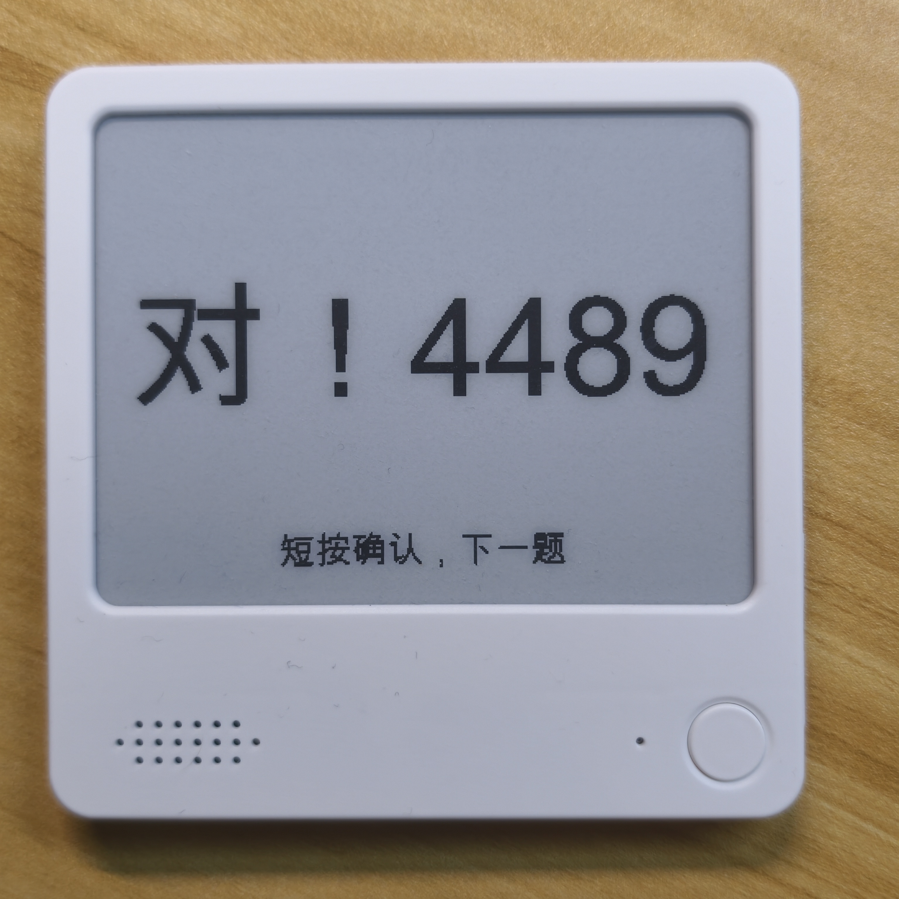

# zectrix-math-drill 两位数乘法口算

**简体中文** | [English](README.en.md)

运行于 ZECTRIX Note 4 墨水屏的口算练习应用：屏幕出题，孩子**长按按键说出答案**，
本地语音识别转成整数，程序判题并在墨水屏显示结果，一组练完给出总结。
全程语音在本机处理，音频不出局域网。





## 功能

- 题目模式：入门（10~30）/ 基础（10~99）/ 进阶（25~99）/ **平方特训**（n²，n∈10~99）
- 组内去重（可选交换律去重：23×14 与 14×23 视为同题），种子可复现
- 中文数字解析：数位读法（三千一百三十六）、逐位读法（七零五六）、「九百」等省略式、
  「两/幺」归一化、阿拉伯数字；识别含语气词或自我修正时**要求重说，绝不静默猜数**
- 判题与统计：首答正确率、订正次数、未识别次数；SQLite 记录每次尝试
- 会话可恢复：断开/重启后 `--resume` 接着练
- 服务模式：设备待机或网络抖动导致断开后自动重连，画面自动恢复

## 硬件与系统要求

| 项 | 要求 |
| --- | --- |
| 设备 | **ZECTRIX Note 4（zectrix-s3-epaper-4.2），固件 3.7.5（zh-CN）**。不支持 Note 4C，固件不可混刷 |
| 宿主机 | macOS（Apple Silicon，本地 ASR 使用 MLX/Metal）；平台适配见 [THIRD_PARTY_NOTICES](THIRD_PARTY_NOTICES.md) |
| 字体 | 含中文的 TTF 单字体（macOS 自带 Arial Unicode；其他平台设 `ZECTRIX_FONT`） |
| 网络 | 宿主机与设备同一局域网；直连设备 IP（设备设置中查看，建议路由器 DHCP 固定） |
| 语音模型 | 首次运行自动下载 Qwen3-ASR-1.7B-8bit（约 2GB，HuggingFace 缓存；直连不通时默认走 hf-mirror） |

> 设备侧注意：停在「设置 → 网络同步」页面时远程画面不渲染；媒体音量为 0 时播放静默
> 「成功」。首次使用请先在设备主界面确认能看到题目、并播放试音（见 `tone` 工具）。

## 使用

```sh
# 1. 核心练习（无需设备）：终端模拟 ASR 文本
cargo run -- -n 10 -d square          # 平方特训；空输入=静音；q=中止

# 2. 墨水屏语音答题（需旁侧克隆 SDK 并启用 device feature）
git clone https://github.com/itopinion/zectrix-local-push-sdk ../repos/zectrix-local-push-sdk
cargo build --features device
./target/debug/drill_device 192.168.31.77 --count 10 --difficulty square
./target/debug/drill_device 192.168.31.77 --resume <会话ID>   # 恢复

# 3. 辅助工具
./target/debug/asr_probe '录音.wav=322'    # 离线验证：WAV→识别→解析→判题
./target/debug/tone 192.168.31.77 100      # 设备试音（排查音量为 0 的静默失败）
```

设备按键：**长按确认键**说话、松开提交；**短按确认**下一题；上键短按重显题目；
下键短按中止（进度保留）。

ASR worker 需要 Python 环境：`python3 -m venv asr-env && asr-env/bin/pip install mlx-audio`，
主程序按 `AsrConfig::default_relative()` 查找 `../asr-env/bin/python` 与 `workers/asr_worker.py`
（`--python/--script` 可覆盖；默认路径以构建时项目目录为基准，不依赖启动目录）。

## 架构

```
src/
  question.rs  出题引擎（难度/去重/种子可复现）
  parser.rs    中文数字解析（全函数：任何输入不 panic，歧义不静默猜）
  session.rs   会话与判题（迟到拒收、重复幂等、首答统计）
  store.rs     SQLite（sessions / questions / attempts）
  app.rs       编排（写通持久化、恢复）
  render.rs    400×300 卡片渲染（基线对齐、二值化输出，抖色零噪斑）
  asr.rs       ASR worker 客户端（JSON-lines 子进程，锁步 + 超时）
  display.rs   显示意图层（文本渲染；设备版为 render.rs）
  main.rs      CLI（模拟 ASR 文本输入）
  bin/drill_device.rs  设备主循环（feature device）
workers/asr_worker.py  本地 ASR（Qwen3-ASR-1.7B-8bit / mlx-audio）
```

更多设计决策见 [docs/DESIGN.md](docs/DESIGN.md)。

## 测试

```sh
cargo test                 # 39+ 用例：解析对抗输入模糊测试、判题不变式、统计口径、持久化往返
cargo test --features device
cargo clippy --all-targets
```

## 数据与隐私

- 录音仅用于识别，**默认识别后立即删除**（`--keep-audio` 可调试保留）；音频与识别全程在本机
- 练习记录（题目、答案、成绩）保存在本机 SQLite（`data/`），不回传任何服务器
- 仓库不包含任何个人数据：`data/`、录音、模型缓存均在 `.gitignore` 中
- 涉及儿童使用时遵循最少采集原则；如需留存样本用于识别质量评估，请自行知情并妥善保管

## 已知边界

- 交互练习要求宿主机程序常驻运行；设备上不运行第三方程序（官方 SDK 形态如此）
- 屏幕刷新约 1~3 秒（gray16 快刷），适合「一题一答」节奏，不适合高频动画
- 断线重连为定时轮询（10s），识别失败仅提示重说不判错；错题重练、难度自适应属后续计划

## 许可

程序代码 MIT，见 [LICENSE](LICENSE)；第三方组件见 [THIRD_PARTY_NOTICES.md](THIRD_PARTY_NOTICES.md)。

## 可靠性改进

- 主动中止的会话支持 `--resume`；正常结束的会话不可恢复。
- 会话头与题目通过同一事务写入；提交及翻题仅在写库成功后更新内存。
- ASR 单次请求采用总时限；超时、协议异常或进程退出后，下次识别自动重启 worker。
- `elapsed_ms` 表示从题目显示到提交的累计时间（包含录音与识别），重说不会丢失计时；不应直接当作纯计算耗时。
